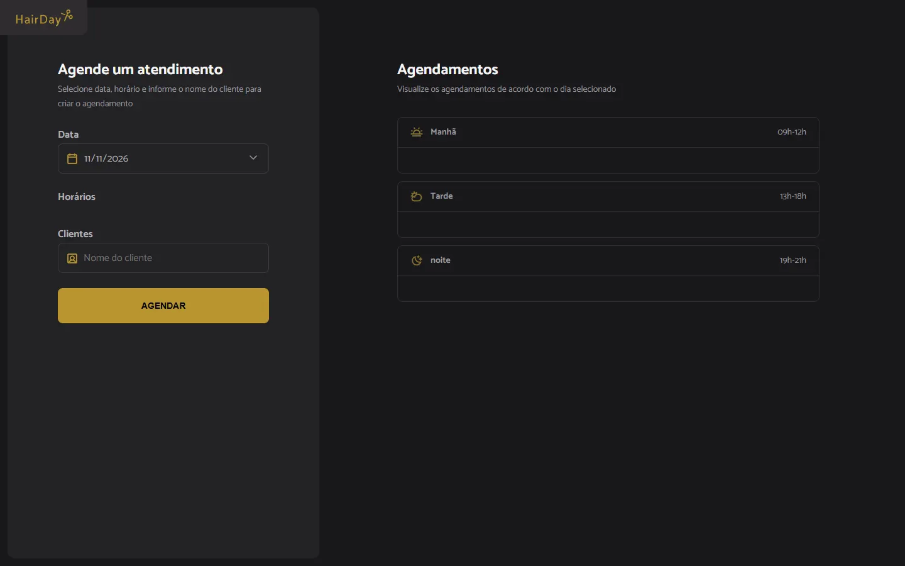
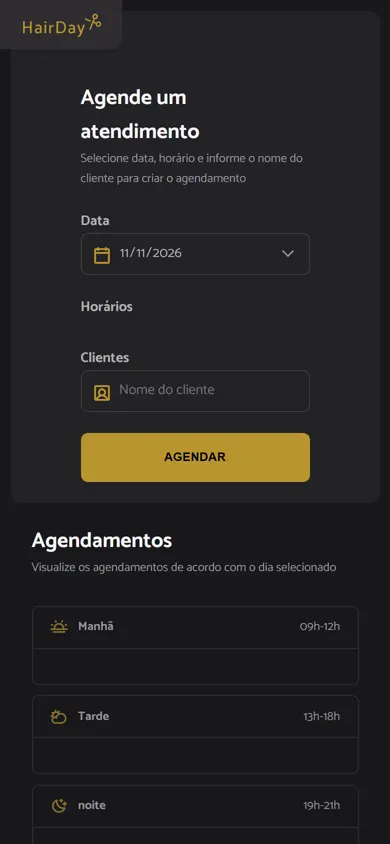

<div align="center">

# ✂️ HairDay

**Agendamento de cortes de cabelo com horários disponíveis em tempo real**


[](https://kevinlopes23.github.io/HairDay/)

<br>

&nbsp;


</div>

## 💡 Sobre

Aplicação web para barbearias e salões: o cliente escolhe a data, um horário livre e informa o nome. Os agendamentos do dia aparecem separados por período e podem ser cancelados. O front-end é empacotado com Webpack e consome uma API REST (JSON Server).

## ✨ Funcionalidades

- Seleção de data com bloqueio de dias passados
- Horários disponíveis calculados a partir dos agendamentos existentes
- Agendamentos agrupados em manhã, tarde e noite
- Cancelamento com confirmação
- Datas e horas com Day.js em pt-BR
- Layout responsivo

## 🛠️ Tecnologias

HTML5 · CSS3 · JavaScript (ES6+, módulos) · Day.js · Webpack · Babel · JSON Server

## 🚀 Como rodar

```bash
git clone https://github.com/KevinLopes23/HairDay.git
cd HairDay
npm install
npm run server   # API fake na porta 3333
npm run dev      # front-end em http://localhost:3000
```

> A versão online usa uma API hospedada no Render (`src/services/api-config.js`); no plano gratuito, a primeira requisição pode demorar alguns segundos.

## 👤 Autor

Feito por [Kevin Lopes](https://github.com/KevinLopes23)
